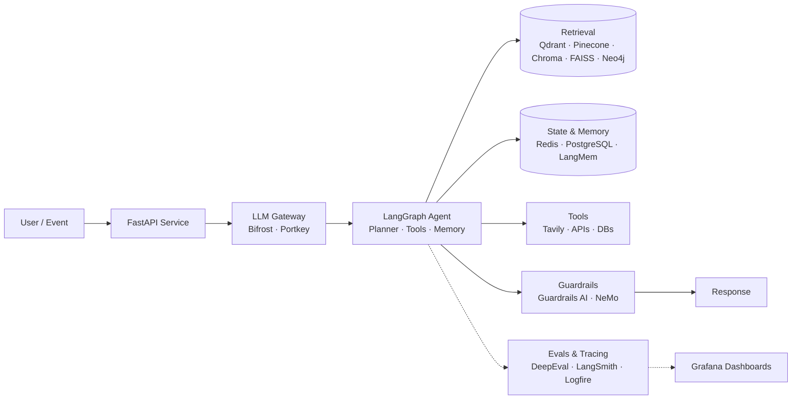

<!-- ======================= HEADER ======================= -->
<div align="center">


<a href="https://git.io/typing-svg">
  
</a>

<br/>


[](https://www.linkedin.com/in/YOUR_LINKEDIN/)
[](mailto:YOUR_EMAIL)
[](https://medium.com/@YOUR_MEDIUM)
[](https://www.kaggle.com/YOUR_KAGGLE)

</div>

---

## 👨‍💻 About Me

I'm an **AI Engineer and Data Scientist** who designs, builds, and ships intelligent systems end to end: from data exploration and predictive modeling to **agentic LLM applications** running reliably in production.

My foundation is classical data science (CRISP-DM, RFM segmentation, fraud and leakage detection, predictive modeling, **time series forecasting**), and I now focus on **agentic AI**: stateful multi-agent workflows, long-term agent memory, hybrid retrieval (vector + graph), evaluation, observability, and AI safety.

```python
class Mustafa:
    roles    = ["AI Engineer", "Data Scientist"]
    location = "Turkey 🇹🇷"
    focus    = ["Agentic AI", "LLM Systems", "RAG", "Agent Memory", "Time Series"]
    stance   = "Ship it, measure it, make it safe, then scale it."

    def currently_exploring(self):
        return ["LangGraph multi-agent patterns", "Memory architectures (LangMem)",
                "AI guardrails & security", "LLMOps / AIOps"]
```

---

## 🎯 What I Do

| | |
|---|---|
| 🤖 **Agentic AI & LLM Engineering** | Stateful agents and multi-agent orchestration with LangGraph and LangChain; tool use, planning, and human-in-the-loop flows |
| 🧠 **Agent Memory & Retrieval** | Short and long-term memory with LangMem; RAG with vector, graph, and hybrid retrieval |
| 🛡️ **Guardrails & AI Safety** | Input/output validation, policy enforcement, and safe deployment of LLM applications |
| 📈 **Evaluation & Observability** | Systematic LLM evaluation, tracing, and monitoring so quality is measured instead of guessed |
| 📊 **Data Science & Time Series** | Forecasting, anomaly and fraud detection, customer segmentation, leakage-safe modeling |
| 🚀 **Deployment & LLMOps** | FastAPI services, containerization, Kubernetes, cloud deployment, and LLM gateways |

---

## 🛠️ Tech Stack

### 🐍 Language & API Development


### 🤖 LLM Frameworks & Orchestration


### 🧠 Agent Memory


### 🗄️ Vector Databases & Similarity Search


### 🕸️ Graph, Relational & NoSQL Databases


### 🌐 Web Search for AI Agents


### 🔀 LLM Gateways & Routing


### 📈 Evaluation, Tracing & Observability


### 🛡️ Guardrails & AI Safety


### 🤝 AI Coding Assistants & Agent Harnesses


### 🧪 Machine Learning


### 🔥 Deep Learning


### 📊 Data Processing, Visualization & Data Apps


### ☁️ Cloud, DevOps & Deployment


---

## 🧭 Stack at a Glance

| Layer | Technologies |
|:--|:--|
| **Language & API development** | `Python` · `FastAPI` · `Pydantic` |
| **LLM frameworks & orchestration** | `LangGraph` · `LangChain` · `LlamaIndex` · `Hugging Face` |
| **Agent memory** | `LangMem` |
| **Vector databases** | `Qdrant` · `Pinecone` · `ChromaDB` |
| **Vector similarity search** | `FAISS` |
| **Graph database** | `Neo4j` |
| **Relational & NoSQL / cache** | `PostgreSQL` · `MongoDB` · `Redis` |
| **Web search for AI agents** | `Tavily` |
| **LLM gateways & routing** | `Bifrost` · `Portkey` |
| **Evaluation & tracing** | `DeepEval` · `LangSmith` · `Pydantic Logfire` |
| **Monitoring** | `Grafana` |
| **Guardrails & AI safety** | `Guardrails AI` · `NVIDIA NeMo Guardrails` |
| **AI coding assistants & harnesses** | `Claude Code` · `Codex` · `DeepSeek harness` |
| **Machine learning** | `scikit-learn` · `XGBoost` · `LightGBM` · `CatBoost` |
| **Deep learning** | `PyTorch` · `TensorFlow` · `Keras` |
| **Data processing & analytics** | `Pandas` · `Databricks` |
| **Visualization & data apps** | `Matplotlib` · `Seaborn` · `Streamlit` |
| **Cloud & DevOps** | `Docker` · `Kubernetes` · `Google Cloud` · `DigitalOcean` |

---

## 🏗️ How I Build Agentic AI Systems



---

## 🎯 Career Focus

I'm focused on roles where I can build and deploy real AI systems:

- 🤖 **AI Engineer**
- 🚀 **Forward Deployed Engineer**
- 🧠 **LLM Engineer**
- 🕸️ **Agentic AI Engineer**
- 📊 **Data Scientist**
- ⚙️ Also a strong fit for **ML Engineer**, **Applied AI**, and related roles

---

## 📈 Time Series & Applied Data Science

Beyond LLMs, I keep working on **time series** problems and applied analytics:

- ⏱️ Forecasting and trend/seasonality analysis
- 🚨 Anomaly and fraud detection
- 🧼 Leakage detection and leakage-safe validation
- 👥 RFM-based customer segmentation
- 🔁 End-to-end projects following **CRISP-DM**

---

## 📌 Featured Projects

<!-- Replace the repo names below with your own best projects -->

<div align="center">

[](https://github.com/YOUR_USERNAME/YOUR_REPO_1)
[](https://github.com/YOUR_USERNAME/YOUR_REPO_2)

[](https://github.com/YOUR_USERNAME/YOUR_REPO_3)
[](https://github.com/YOUR_USERNAME/YOUR_REPO_4)

</div>

---

## 📊 GitHub Stats

<div align="center">


<br/>


</div>

---

## 🤝 Let's Connect

I'm always open to conversations about **agentic AI, LLM systems, time series, and production ML**. If you're building something interesting, reach out.

<div align="center">

[](https://www.linkedin.com/in/YOUR_LINKEDIN/)
[](mailto:YOUR_EMAIL)

<br/>

*"Models are easy to demo, hard to ship. I like the hard part."*


</div>
